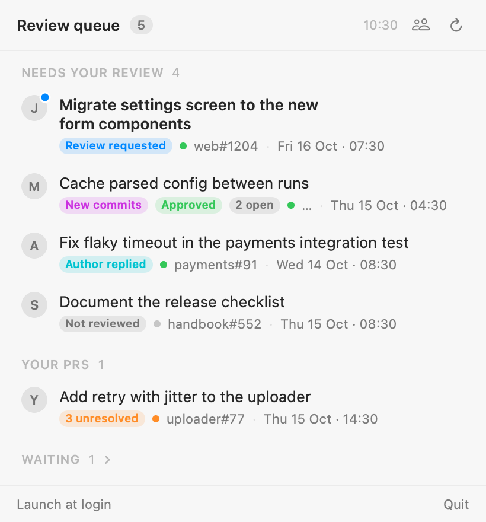
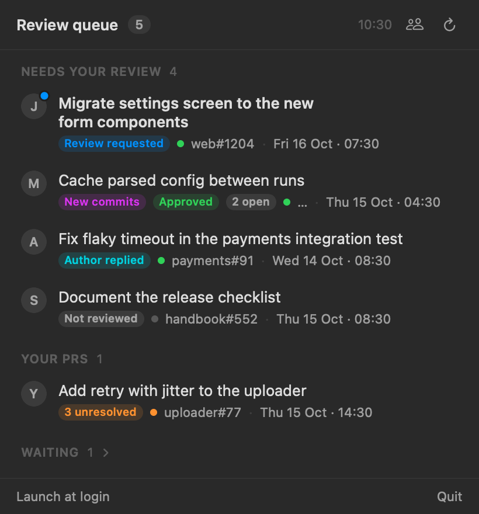

# Review Queue

[](https://github.com/sam-cook/review-queue/actions/workflows/ci.yml)


A small macOS menu bar app that shows the GitHub pull requests that need **your** attention
right now, and nothing else.

It watches PRs from the teammates you choose, plus any PR you were asked to review or have
already reviewed or commented on. It works out where each one is in the review cycle, and
puts a PR in front of you only when the next move is yours: a new review request, new
commits after your review, a reply from the author, or unaddressed feedback on your own PR.

<p align="center">
  
  
</p>

Works with **github.com** and **GitHub Enterprise Server**. Native SwiftUI, no server, no
dependencies, read-only.

## Install

You need **macOS 14 (Sonoma) or later** and the **[GitHub CLI](https://cli.github.com)**,
logged in. The app borrows `gh`'s token, so it never asks for or stores a password.

```sh
brew install gh
gh auth login
```

### Option A: download

1. Download `ReviewQueue-x.y.z.zip` from the [latest release](https://github.com/sam-cook/review-queue/releases/latest) and unzip it.
2. Move **Review Queue.app** to `~/Applications` (or `/Applications`).
3. The app is not notarised by Apple, so macOS blocks the first launch. Open it once, then go
   to **System Settings → Privacy & Security** and click **Open Anyway**. Or run:

   ```sh
   xattr -dr com.apple.quarantine ~/Applications/Review\ Queue.app
   ```

   The app does not update itself. Watch the repository's releases, or use Option B.

### Option B: build from source

Needs the Xcode Command Line Tools (`xcode-select --install`); full Xcode is not required.

```sh
git clone https://github.com/sam-cook/review-queue.git
cd review-queue
make install
```

`make install` builds a universal app (Apple silicon and Intel), installs it to
`~/Applications`, and starts it. Run it again after `git pull` to update.

## First run

1. Click the pull-request icon in the menu bar.
2. Type the GitHub usernames of the people whose PRs you review, pressing Return after each.
   Each name is checked against GitHub. You can skip this: review requests and PRs you are
   already involved in show up anyway.
3. Allow notifications when macOS asks.
4. Optional: turn on **Launch at login** in the panel footer.

Edit the team at any time with the people icon in the panel header.

## What it shows

### Needs your review

| Situation | Label |
| --- | --- |
| Someone requested your review | Review requested |
| Your review was requested again, or your review was dismissed | Re-review requested |
| New commits or a force-push landed after your review or comment | New commits |
| The author replied after your review or comment | Author replied |
| A teammate opened a PR in the last 7 days and you have not reviewed it | Not reviewed |

### Your PRs

Your own open PRs, drafts included, appear when they have feedback you have not addressed:

| Situation | Label |
| --- | --- |
| Someone requested changes after your last push | Changes requested |
| Review threads are unresolved and the last reply is not yours | *N* unresolved |
| A reviewer commented after your last push or comment | New comments |

### Waiting, and hidden

| Situation | Where |
| --- | --- |
| You reviewed and nothing happened since | Waiting (collapsed) |
| Someone else requested changes and the author has not pushed since | Waiting |
| You approved it | Hidden |
| Someone else approved it and you were never involved | Hidden |
| A draft by someone else, or a closed or merged PR | Hidden |

Details that keep the list honest:

- Approvals from bots (GitHub Apps and other `Bot` accounts) do not count.
- On your PRs, only comments from people who reviewed or were asked to review count, so
  status comments from CI services do not.
- If someone else approved a PR you are involved in, it stays with an **Approved** pill (it
  may merge soon), and an **N open** pill when your review threads are still unresolved.
- Each row shows the author, a CI dot (green passed, orange running, red failed), the
  repository and number, and when the PR was opened.

### Badge and notifications

- The badge counts the PRs that need you: reviews to do plus your PRs with feedback.
- It turns **red** when something new needs you, and goes back to the menu bar colour when
  you open the panel.
- Each new event posts one macOS notification (for example "New commits · alice"). Click it
  to open the PR.

### Dismissing

- Hover a row and click **×** to dismiss it *until something changes*. It comes back by itself
  when it needs you for a new reason.
- Right-click a row for **Always Hide This PR**, **Copy Link** and **Open in Browser**.
- Dismissed and hidden PRs are in the collapsed **Dismissed** section, where you can restore them.

## Settings

Optional. Set them with `defaults write`, then restart the app (Quit in the panel footer, then
open it again).

| Key | Default | Meaning |
| --- | --- | --- |
| `host` | `github.com` | A GitHub Enterprise Server host, for example `github.example.com` (a port is allowed) |
| `windowDays` | `7` | How far back to look for teammates' unreviewed PRs |
| `refreshInterval` | `300` | Seconds between refreshes (minimum 60) |

```sh
# Use GitHub Enterprise Server
gh auth login --hostname github.example.com
defaults write io.github.sam-cook.review-queue host github.example.com

# Refresh every 10 minutes
defaults write io.github.sam-cook.review-queue refreshInterval -int 600
```

The app also refreshes when your Mac wakes, when you open the panel (if the data is more than
a minute old), and on ⌘R.

## Privacy and security

- **Read-only.** The app only reads from GitHub. It never comments, approves, or changes anything.
- **No stored credentials.** It runs `gh auth token` for each request and keeps the token only
  in memory. Like `gh`, it uses `GH_TOKEN` / `GITHUB_TOKEN` when set for github.com, and
  `GH_ENTERPRISE_TOKEN` / `GITHUB_ENTERPRISE_TOKEN` for an Enterprise host.
- **Talks only to GitHub.** No analytics, no other servers. On github.com your token is never
  sent to the avatar servers.
- **Local state only.** Your team list and dismissed PRs live in macOS user defaults
  (`io.github.sam-cook.review-queue`).

See [SECURITY.md](SECURITY.md) to report a problem.

## API usage

One refresh is a single GraphQL request with up to five searches of 40 PRs each. That costs
at most about 210 points of the 5,000 an hour that github.com allows, and usually far fewer.
At the default 5-minute interval, it stays well inside the limit even with `gh` and other
tools sharing it. If GitHub reports a rate limit, the app pauses for 10 minutes and says so.

## Troubleshooting

| Problem | Fix |
| --- | --- |
| "No GitHub token" in the panel | Run `gh auth login` (or `gh auth login --hostname <host>` for Enterprise) |
| "GitHub rejected the token" | Run `gh auth refresh` |
| No icon in the menu bar | Check it runs: `pgrep -x ReviewQueue`. On a crowded menu bar, icons can hide behind the notch. |
| No notifications | System Settings → Notifications → Review Queue |
| "Review Queue can't be opened" | See step 3 of [Option A](#option-a-download) |

To see what the app sees without the UI:

```sh
~/Applications/Review\ Queue.app/Contents/MacOS/ReviewQueue --dump
```

`--help` lists every option, including `--demo` (made-up data; it makes no network requests).

## Uninstall

```sh
make uninstall
```

This turns off **Launch at login**, quits the app, deletes it, and removes its settings. By
hand: turn off **Launch at login** in the panel, Quit, delete `Review Queue.app`, and run
`defaults delete io.github.sam-cook.review-queue`.

## Known limits

- A review requested from a GitHub **team** you belong to is not shown as "Review requested".
  A teammate's PR still shows as "Not reviewed".
- "Author replied" counts only comments by the PR author.
- Each search returns at most 40 PRs; very busy accounts may miss some older ones.
- Only the last 40 timeline events and 50 review threads of each PR are read.

## Development

```sh
make test         # run the tests
make demo         # run the app with made-up data
make app          # build dist/Review Queue.app
make screenshots  # regenerate docs/*.png from demo data
```

The code is a Swift package:

| Path | What |
| --- | --- |
| `Sources/ReviewQueueCore/` | Everything testable: models, the review rules (`Classifier`), the GraphQL query, the GitHub client, queue state |
| `Sources/ReviewQueue/` | The menu bar app: store, SwiftUI views, menu bar icon, notifications, command-line modes |
| `Tests/ReviewQueueCoreTests/` | Swift Testing suites; the client is tested against a stubbed `URLProtocol` |
| `scripts/` | Test, build and install scripts |

See [CONTRIBUTING.md](CONTRIBUTING.md) before you open a pull request.

## License

[MIT](LICENSE)
